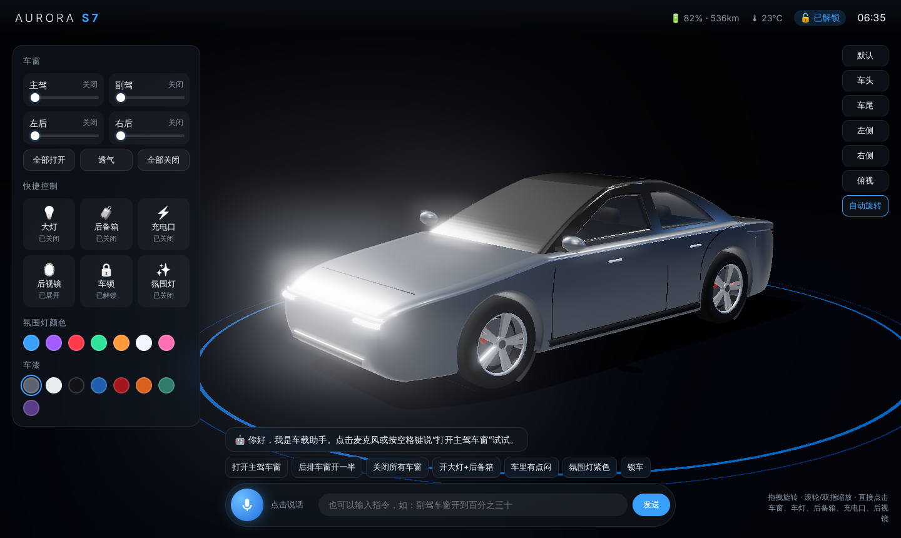
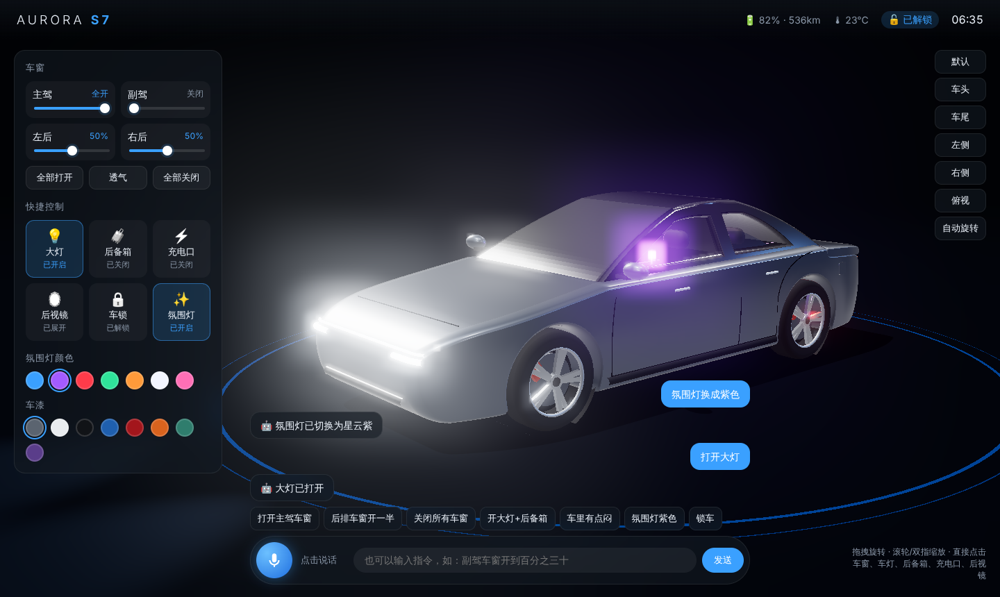
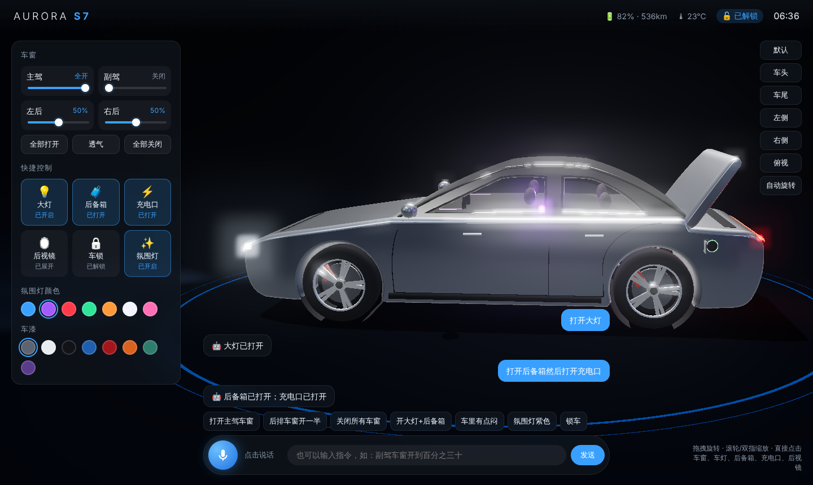
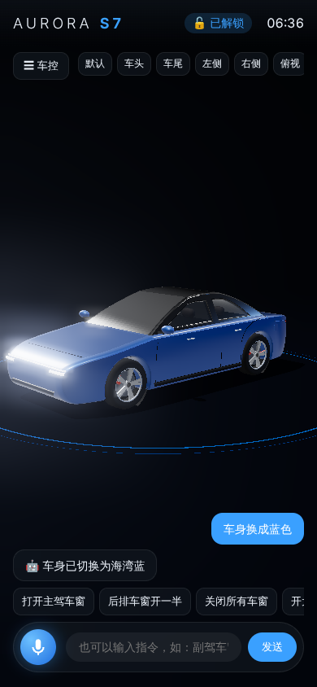

# 3D 仿真车模 · 智能车控 Demo

用 Vibe Coding 方式实现的网页版 3D 车模：**可拖动旋转、可点击控车、可语音控车**，界面参考新能源汽车中控大屏。



| 语音开窗 + 氛围灯 + 大灯 | 后备箱 + 充电口 | 手机端 |
| --- | --- | --- |
|  |  |  |

## 一、运行

ES Module 加上麦克风权限，都要求页面通过 `http://localhost` 或 `https` 打开，**不能直接双击 index.html**。

```bash
cd car-demo
node server.mjs          # 零依赖，任意 Node 16+ 都可以
# 或者：python3 -m http.server 8080
```

然后用浏览器打开 <http://localhost:8080>。three.js 已放在本地 `vendor/` 目录，**断网也能运行**。

### 浏览器建议（语音识别）

| 浏览器 | 语音识别 | 说明 |
| --- | --- | --- |
| **Microsoft Edge（推荐）** | ✅ | 走微软语音服务，国内一般能直接用 |
| Safari（macOS / iOS） | ✅ | 走苹果语音服务 |
| Chrome | ⚠️ | 走 Google 服务，国内网络下通常报 `network` 错误 |
| Firefox | ❌ | 不支持 Web Speech 识别 |

识别不可用时，可以在页面底部**直接输入文字指令**，它和语音走的是同一套语义理解（NLU）和执行逻辑，现场演示不会卡住。

## 二、功能

| 能力 | 交互方式 |
| --- | --- |
| 360° 旋转 / 缩放 / 视角预设 | 鼠标拖拽、滚轮、双指；右侧「车头 / 车尾 / 侧面 / 俯视」；空闲时自动旋转 |
| **点击控车** | 直接点 3D 模型上的**车窗**（升降）、**车灯**、**后备箱**、**充电口**、**后视镜**；悬停时有高亮和提示 |
| 面板控车 | 4 个车窗的开度滑杆、透气、全开 / 全关，以及大灯、后备箱、充电口、后视镜、车锁、氛围灯、车漆 |
| **语音控车** | 点麦克风或按 **空格键** 说话，识别结果实时显示，执行后语音播报回复 |

### 语音指令示例

| 类别 | 例句 |
| --- | --- |
| 车窗（指定位置） | 打开主驾车窗 / 关闭副驾驶的车窗 / 降下左后车窗 / 升起右后车窗 |
| 车窗（开度） | 后排车窗开一半 / 副驾车窗开到百分之三十 / 车窗开到40% / 开条缝透透气 |
| 车窗（隐式意图） | 车里有点闷 → 全部车窗通风 25%；下雨了 / 好冷 → 关闭全部车窗 |
| 上下文追问 | 「打开副驾车窗一半」→「再开大一点」（沿用上一句的副驾目标） |
| 多意图 | 打开大灯然后打开后备箱 |
| 其他 | 锁车 / 解锁 / 打开充电口 / 折叠后视镜 / 氛围灯换成紫色 / 车身换成蓝色 / 看看车尾 / 你能做什么 |

## 三、技术方案

```
麦克风 ──► ASR 语音识别 ──► NLU 语义理解 ──► 车控 API ──► 3D 动画
          (Web Speech API)   (js/nlu.js 规则)   (Car 类)     (three.js)
                                    │
                                    └──► 回复文案 ──► TTS 语音播报 (speechSynthesis)
点击 3D 部件 (Raycaster) ───────────────────────► 车控 API
面板按钮 / 滑杆 ─────────────────────────────────► 车控 API
```

- **车模**：用 three.js 程序化建模，没有外部模型文件。先画侧视轮廓，再做“枕头式”挤出：侧面用 Delaunay 网格细分，再做俯视收窄和侧面鼓起的变形，得到平滑车身。玻璃舱有内倾（tumblehome）。车窗、后备箱盖、充电口盖、后视镜都是独立部件，所以每一个都能单独做动画。
- **车窗升降**：玻璃整体向下平移，同时用 `clippingPlanes` 在腰线处裁掉下半截，效果就像玻璃降进车门。车窗位置另有一块不可见的「点击热区」，玻璃降下后点窗框里的空洞也能把它关上。
- **装饰件贴合车身**：灯带、钣金缝、门把手、充电口的位置都是用射线投射到车身表面求出来的，所以以后改车身造型，这些装饰会自动跟着贴合。
- **状态驱动**：`Car.state` 是唯一的数据源。点击、面板、语音都只调用 `car.setWindow()` 这一类 API，动画每帧向目标状态平滑逼近，UI 通过 `onChange` 同步。
- **NLU**：纯规则实现，不需要联网，也不需要 API Key。支持中文数字、百分比、多意图拆句、隐式意图、上下文追问，有 23 个单元测试。

## 四、目录结构

```
car-demo/
├── index.html          # 页面结构（中控风格 UI）
├── style.css           # 样式（含手机端适配）
├── server.mjs          # 零依赖本地静态服务器
├── js/
│   ├── main.js         # 场景、相机、后处理、点击拾取、面板、语音串联
│   ├── car.js          # 车模建模 + 部件动画 + 车控 API
│   ├── nlu.js          # 中文车控指令理解（纯函数，可在 Node 中测试）
│   └── voice.js        # 语音识别 / 语音播报封装
├── tests/nlu.test.mjs  # NLU 单元测试：node tests/nlu.test.mjs
├── vendor/             # three.js r170、delaunator（本地化，离线可用）
└── docs/
    ├── VIBE_CODING_GUIDE.md   # ★ 怎样一步步指挥 AI 完成本作业（录屏脚本）
    └── screenshots/
```

## 五、测试

```bash
node tests/nlu.test.mjs
```

## 六、部署（可选）

这是纯静态站点，整个 `car-demo/` 目录可以直接部署到 GitHub Pages、Vercel 或 Netlify。部署后是 https 地址，手机上也能用麦克风，评审拿到链接就能体验。
